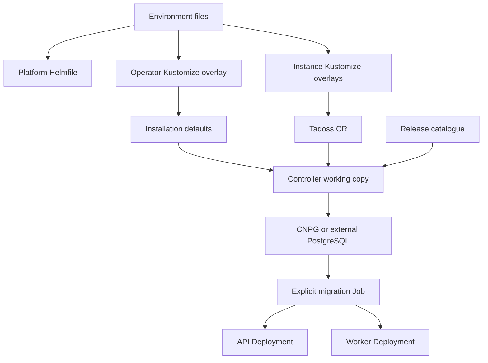

# Architecture and configuration flow

TADOSS adopts the applicable TAMOSS project groups: runtime source, operator, platform deployment, per-environment configuration, operational documentation, tests and release artifacts. It has no media service, user interface or managed identity provider.

The platform is shared infrastructure. The operator installation supplies policy defaults. The instance expresses workload intent. Explicit instance fields win over installation defaults; the selected profile fills workload sizes. A version catalogue binds runtime image and schema target. Invalid configuration leaves existing workloads intact and produces a condition.

PostgreSQL transactions contain both data mutations and notification jobs. A worker claims bounded jobs with a lease and fencing token; stale claims cannot commit completion. Webhooks use bounded retries and terminal-job expiry. Event deletion captures a mutation sequence cutoff, so later inserts and updates survive. Whole-track deletion reserves the track until completion; deletion ranges update as batches finish.

Collection and event pagination use SQL keysets. API memory is bounded by page and batch sizes. PostgreSQL range columns preserve exact time ordering and overlap constraints. Application-level validation and database constraints both protect writes.
